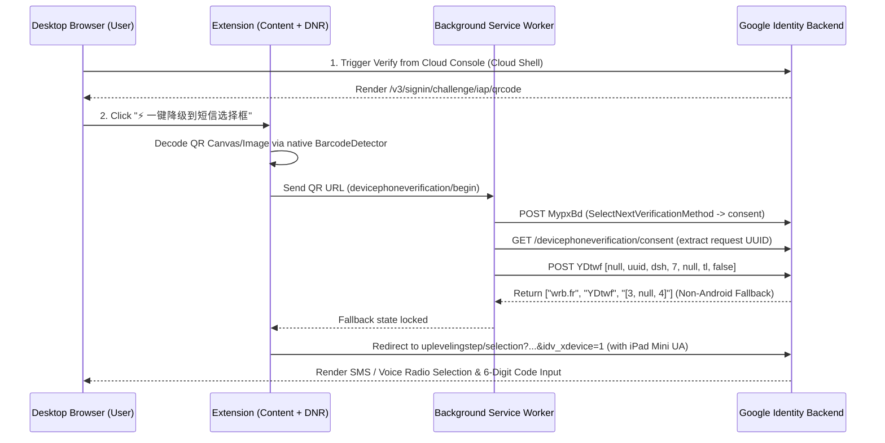

# Google QR SMS Helper (`google-qr-sms-helper`)

<p align="center">
  
  
  
  
</p>

<p align="center">
  <b>Switch Google's mandatory cross-device QR verification (Constellation / MO-SMS) back to standard 6-digit SMS / Voice verification on desktop browsers.</b><br/>
  将 Google 桌面端强制跨设备扫码验证（MO-SMS / GMS Constellation）一键降级回传统的「输入手机号接收 6 位短信验证码」流程。
</p>

---

## 📖 Background / 背景说明

When verifying or upgrading a Google account on desktop browsers, Google increasingly enforces `/v3/signin/challenge/iap/qrcode` (`DevicePhoneVerificationUi`), which requires scanning a QR code with a mobile phone to trigger either:
1. **Android GMS Constellation (`PhoneIdentityJsBridge.verifyPhoneNumber`)** — hardware/SIM-bound silent carrier SMS verification.
2. **Mobile-Originated SMS (MO-SMS)** — sending an outbound international SMS to Google's gateway.

If you are working in an environment without an active Android GMS device or international outbound SMS capability, `google-qr-sms-helper` automates the official cross-device fallback protocol (`idv_xdevice=1` + non-Android `GetVerificationStatus` status `[3, null, 4]`) and maintains a consistent `iPad Mini` (`iPadOS`) header/navigator profile across the entire `uplevelingstep` and `batchexecute` verification lifecycle.

---

## ✨ Architecture & Workflow / 工作原理



### Key Technical Details / 核心技术要点
1. **Cloud Shell Entrypoint (`console.cloud.google.com`)**:
   Triggering verification from Google Cloud Console's **Cloud Shell (`[>_]`) -> `Verify`** generates a clean `uplevelingstep/selection?TL=...&authuser=0&flowName=GlifWebSignIn&sarp=1&scc=1` continuation token without nested third-party OAuth redirects.
2. **Native QR Extraction (`BarcodeDetector`)**:
   Extracts the `devicephoneverification/begin` URL directly from the DOM `` / `<canvas>` element in milliseconds without external dependencies or screenshots.
3. **Full-Path `iPad Mini` Header Consistency (v1.1.0)**:
   Uses Chrome's `declarativeNetRequest` to enforce the `iPad Mini` User-Agent (`CPU OS 16_6 like Mac OS X ... Mobile/15E148`) and strip desktop Client Hints (`Sec-CH-UA*`) across **all** `accounts.google.com/*` routes—including `/uplevelingstep/*`, `/v3/signin/challenge/*`, and the `/_/IdvUplevelingUi/data/batchexecute` RPC endpoint used when submitting the 6-digit SMS code.

---

## 🚀 Installation / 安装方法

### Option 1: Load Unpacked Extension / 加载已解压扩展
1. Clone this repository or download the latest ZIP from [Releases](https://github.com/havenicec/google-qr-sms-helper/releases):
   ```bash
   git clone https://github.com/havenicec/google-qr-sms-helper.git
   ```
2. Open Chrome and navigate to `chrome://extensions/`.
3. Enable **Developer mode** (开发者模式) in the top-right corner.
4. Click **Load unpacked** (加载已解压的扩展程序) in the top-left corner and select the `google-qr-sms-helper` folder.

---

## 🛠️ Usage / 使用步骤

1. **Step 1 — Open Cloud Console**:
   Log in to your Google account and visit [https://console.cloud.google.com/](https://console.cloud.google.com/).
2. **Step 2 — Trigger Cloud Shell Verification**:
   Click the **Activate Cloud Shell (`[>_]`)** icon in the top-right navigation bar (or click the extension's floating button **`1. 自动点击 Cloud Shell 终端图标`**), then click **`Verify`** in the modal dialog.
3. **Step 3 — One-Click Downgrade**:
   On the QR code verification page (`/v3/signin/challenge/iap/qrcode`), click the floating button **`⚡ 一键降级到短信选择框`** in the bottom-right corner.
4. **Step 4 — Receive 6-Digit SMS Code**:
   The page will automatically transition to the `uplevelingstep/selection` screen. Select **Text message (SMS)**, enter your phone number, and submit the 6-digit `G-xxxxxx` verification code.

---

## 📁 Project Structure / 目录结构

```text
google-qr-sms-helper/
├── manifest.json     # Chrome Extension Manifest V3 configuration
├── background.js     # DNR User-Agent rules + MypxBd / YDtwf [3,null,4] RPC handler
├── content.js        # Floating UI + native BarcodeDetector QR extraction + URL sanitizer
├── ua_spoof.js       # Main-world navigator spoof for iPad Mini consistency
├── LICENSE           # MIT License
└── README.md         # Documentation
```

---

## 📄 License

Released under the [MIT License](./LICENSE).
