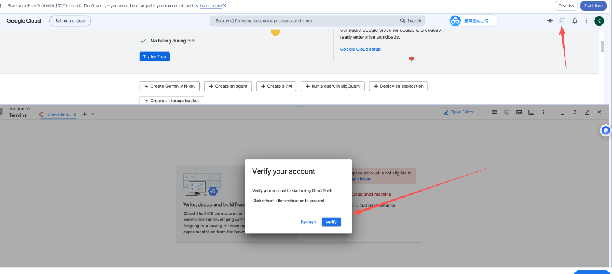
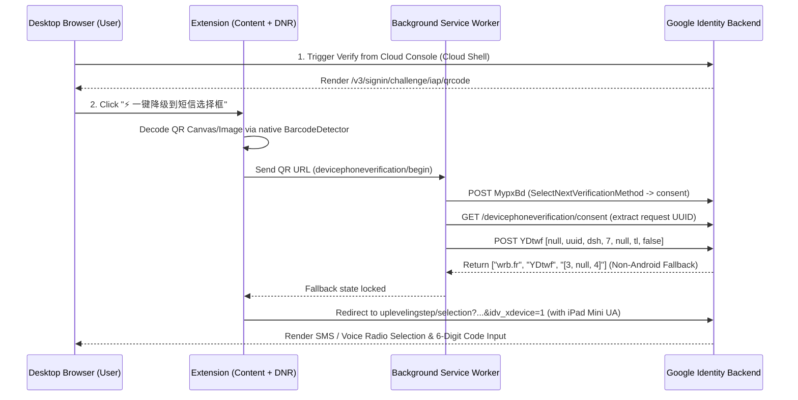

# Google QR SMS Helper (`google-qr-sms-helper`)

<p align="center">
  
  
  
  
</p>

<p align="center">
  <b>将 Google 桌面端强制跨设备扫码验证（MO-SMS / GMS Constellation）一键降级回传统的「输入手机号接收 6 位短信验证码」流程。</b><br/>
  Switch Google's mandatory cross-device QR verification back to standard 6-digit SMS / Voice verification on desktop browsers.
</p>

---

## 📦 一、安装教程 (Installation)

### 方式 1：直接下载 Release 压缩包（推荐新手）
1. 前往本仓库的 **[Releases 页面](https://github.com/havenicec/google-qr-sms-helper/releases/latest)**，下载最新的 `google-qr-sms-helper-v1.1.0.zip` 并解压到本地文件夹。
2. 打开 Chrome / Edge / Brave 浏览器，在地址栏输入 `chrome://extensions/` 并回车。
3. 打开页面右上角的 **「开发者模式 (Developer mode)」** 开关。
4. 点击左上角的 **「加载已解压的扩展程序 (Load unpacked)」**，选中刚才解压出来的文件夹即可完成安装。

### 方式 2：通过 Git 克隆安装
```bash
git clone https://github.com/havenicec/google-qr-sms-helper.git
```
然后在 `chrome://extensions/` 中开启「开发者模式」，点击「加载已解压的扩展程序」并选择 `google-qr-sms-helper` 目录。

---

## 🚀 二、保姆级图文使用教程 (Step-by-Step Usage Guide)

> [!IMPORTANT]
> **核心前提（必看）**：**不要**直接从第三方客户端（如 Antigravity / Gemini Code Assist 授权页）弹出的二维码页面降级（因为其 `continue` 参数包含多层嵌套重定向，会被 Google 重新拦截回二维码）。  
> **必须先打开 Google Cloud Console 通过 Cloud Shell 唤出原生的 `Verify` 窗口**！在这里过完一次短信验证后，你的 Google 账号权限将全局解锁，再回 Antigravity 等工具登录即可直接丝滑通过。

### 第 1 步：打开 Google Cloud Console 并唤起 Cloud Shell 验证
1. 在浏览器中登录你需要验证的 Google 账号，访问 **[https://console.cloud.google.com/](https://console.cloud.google.com/)**。
2. 如下图所示，点击页面右上角导航栏的 **「激活 Cloud Shell」终端图标 `[>_]`**（或者直接点击页面右下角插件悬浮窗里的 **`1. 自动点击 Cloud Shell 终端图标`** 按钮）。
3. 在底部弹出的 `Verify your account` 窗口中，点击蓝色的 **`Verify`** 按钮：



---

### 第 2 步：在二维码页面点击「一键降级到短信选择框」
1. 点击 `Verify` 后，会弹出 Google 的二维码验证页面（`/v3/signin/challenge/iap/qrcode`）。
2. 等待二维码图片加载出来后，点击页面右下角插件悬浮面板上的 **「⚡ 一键降级到短信选择框」** 按钮：
   - 插件会自动调用浏览器原生 `BarcodeDetector` 识别页面上的二维码；
   - 自动在后台向 Google 发送 `MypxBd` 与 `YDtwf ([null, uuid, dsh, 7, null, tl, false])` 数据包，拿到 `[3, null, 4]`（非 Android 设备回退短信验证状态）；
   - 自动将当前标签页的请求头与环境伪装为 **`iPad Mini`**（无需手动按 F12 切换设备），并重定向到 `uplevelingstep/selection?...&idv_xdevice=1`。

---

### 第 3 步：选择「短信 (Text message)」并输入手机号接码
1. 页面会自动跳转进带有单选框的 **验证方式选择页 (`/uplevelingstep/selection`)**：
   - 勾选 **Text message (SMS) / 短信**（或语音通话），点击下一步。
2. 在手机号输入框中填入你的接码手机号（支持任意国家/地区的接码平台号码或实体卡号），点击发送验证码。
3. 收到 `G-xxxxxx` 的 6 位数字验证码后填入并点击 **Next**，即可完成账号验证！
4. 验证通过后，回到 Cloud Shell 或 Antigravity / Gemini CLI 刷新即可正常使用。

---

## ❓ 三、常见问题与避坑指南 (FAQ & Troubleshooting)

### Q1: 为什么我从别的链接点进二维码页，点降级后又跳回了二维码？
- **原因**：只有从 `https://console.cloud.google.com/` 点击右上角 **Cloud Shell `[>_]` -> `Verify`** 唤出的二维码页，其 `continue` 参数才是纯净的 `https://accounts.google.com/uplevelingstep/selection?TL=...&authuser=0&flowName=GlifWebSignIn&sarp=1&scc=1`。请务必按「第 1 步」从 Cloud Shell 入口进入。

### Q2: 为什么插件默认伪装成 `iPad Mini` 而不是 `iPad Pro` 或桌面浏览器？
- **原因**：Google 的 `uplevelingstep/selection` 接口会校验 `User-Agent`：
  - 桌面端（Windows / macOS）以及 Chrome F12 中的 `iPad Pro 13` 发送的都是 `Macintosh; Intel Mac OS X` 桌面级 UA，Google 检测到桌面环境会无视 `idv_xdevice=1` 强行跳回二维码。
  - 而 `iPad Mini` 发送的是纯移动端 `iPad; CPU OS 16_6 like Mac OS X ... Mobile/15E148` 请求头，且在提交 6 位验证码的 `/_/IdvUplevelingUi/data/batchexecute` 接口上必须保持前后完全一致的 `iPad Mini` 请求头（已在 v1.1.0 中通过 `declarativeNetRequest` 全路径自动覆盖，无需手动开 F12）。

### Q3: 点击「一键降级」提示“未能在当前页面识别到二维码”怎么办？
- 请确认使用的是 **Chrome / Edge 88+** 浏览器（支持原生 `BarcodeDetector` 接口），并等待页面上的黑色二维码图案完全显示后再点击按钮。

---

## ✨ 四、技术原理与工作流 (Architecture & Workflow)



---

## 📁 目录结构 (Project Structure)

```text
google-qr-sms-helper/
├── assets/
│   └── cloud-shell-verify.png  # Cloud Shell Verify 入口示意图
├── manifest.json               # Chrome Extension Manifest V3 配置文件
├── background.js               # DNR 全路径 iPad Mini 请求头伪装 + [3,null,4] RPC 注入
├── content.js                  # 悬浮控制面板 + BarcodeDetector 二维码识别 + URL 清洗跳转
├── ua_spoof.js                 # Main-world navigator 属性对齐
├── LICENSE                     # MIT 开源协议
└── README.md                   # 项目说明与图文教程
```

---

## 📄 License

Released under the [MIT License](./LICENSE).
